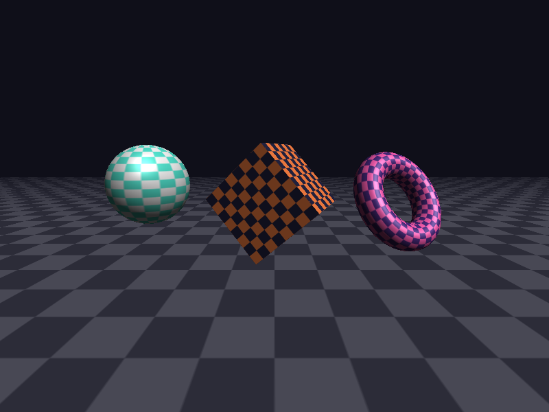

# IrisGPU

A CPU-based 3D software renderer written from scratch in C++20. No OpenGL, no Vulkan,
just math, a framebuffer, and SDL2 to put pixels on screen.



## Features

- Real matrix pipeline: `Mat4::perspective`, `Mat4::lookAt`, model/view/projection in clip space
- Programmable **vertex shader** and **fragment shader** (`std::function` callbacks)
- Homogeneous **frustum clipping** against all 6 planes (Sutherland-Hodgman in clip space)
- Backface culling via signed screen-space area
- Edge-function rasterizer with incremental barycentrics
- Perspective-correct interpolation of UVs and normals
- Z-buffer depth testing
- **Multithreaded rasterization** (screen split into bands, work-stealing across threads)
- Blinn-Phong lighting, distance fog, bilinear texture filtering with repeat wrap
- Mesh generators (cube, sphere, torus, plane) and a Wavefront **OBJ loader**
- Debug shading modes: lit, unlit, normals, depth
- Headless rendering (`--render`) and benchmarking (`--bench`)
- Unit tests + GitHub Actions CI

## Pipeline

```
MeshInstance -> model matrix
      |
Vertex shader (MVP -> clip space, normals -> view space)
      |
Frustum clipping (6 planes, clip space)
      |
Perspective divide -> Viewport transform
      |
Backface culling -> fan triangulation
      |
Tile/band rasterization (multithreaded) -> depth test
      |
Fragment shader (perspective-correct uv + normal)
      |
Framebuffer -> SDL2 window
```

3D Geometry
    ↓
Transformations
    ↓
Projection
    ↓
Viewport Transformation
    ↓
Triangle Rasterization
    ↓
Depth Testing
    ↓
Framebuffer
    ↓
SDL2 Display

## Technology Stack

- C++
- CMake
- SDL2
- Git

## Building

Install dependencies:

```bash
sudo apt install build-essential cmake libsdl2-dev
